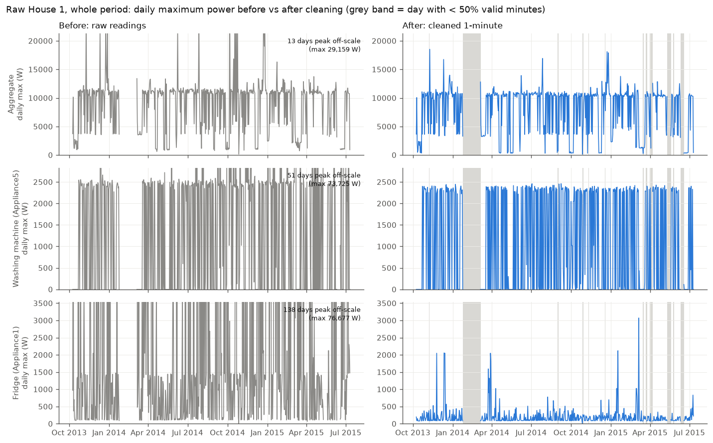
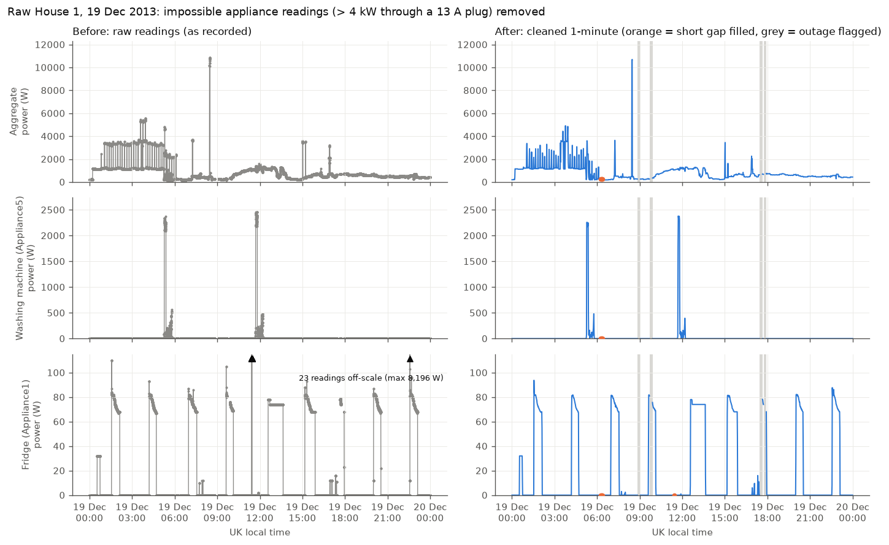
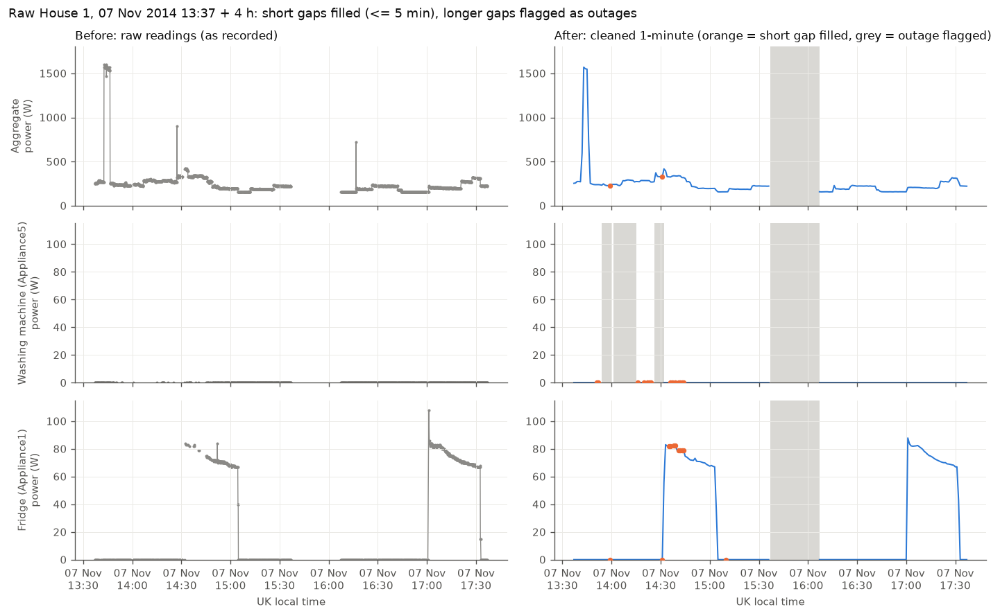

# DATA

This file covers the data: what REFIT contains, the Section 1 inspection and cleaning of raw
House 1, and the checks and decisions applied to the official cleaned data used in Sections 2
and 3. Results are in [RESULTS.md](RESULTS.md); the overview is in [README.md](README.md).

Every number below is produced by code in `src/` and saved under `outputs/` (file names in
brackets), so it can be regenerated with `python run_all.py`.

**Contents**

- [1. Dataset](#1-dataset)
- [2. Section 1: raw House 1](#2-section-1-raw-house-1)
  - [2.1 Inspection findings](#21-inspection-findings)
  - [2.2 Timestamp rule](#22-timestamp-rule)
  - [2.3 Cleaning pipeline](#23-cleaning-pipeline)
  - [2.4 Before and after plots](#24-before-and-after-plots)
  - [2.5 Cross-check against the official cleaned House 1](#25-cross-check-against-the-official-cleaned-house-1)
  - [2.6 Remaining concerns](#26-remaining-concerns)
- [3. Official cleaned data used for Sections 2 and 3](#3-official-cleaned-data-used-for-sections-2-and-3)
- [4. Our findings about the official cleaned data](#4-our-findings-about-the-official-cleaned-data)
- [5. Decisions for Sections 2 and 3](#5-decisions-for-sections-2-and-3)

---

## 1. Dataset

**REFIT Electrical Load Measurements** (University of Strathclyde), licence CC BY 4.0.
20 UK households near Loughborough, numbered 1–21 (there is no House 14). Each house has one
aggregate current clamp and 9 Individual Appliance Monitors (IAMs) on plugs.

- **Units:** active power in watts (W).
- **Sampling:** nominally every 8 seconds, but the sensors are not synchronised (the logger
  polled every 6–8 s) and values were only logged when the load changed. In practice the
  interval is irregular (see §2.1 and §3).
- **Coverage:** October 2013 to June 2015 according to the dataset page (the files run to
  10 July 2015), with a known large gap in February 2014.

| Use | Files | Period in file |
|---|---|---|
| Section 1 (raw cleaning) | `RAW_House1_Part1.csv` (4,377,877 rows) and `RAW_House1_Part2.csv` (4,140,886 rows) from `REFIT_RAW_081116.7z` | 9 Oct 2013 – 10 Jul 2015 |
| Sections 2–3 (EDA, model) | `CLEAN_House{N}.csv` from `CLEAN_REFIT_081116.7z`, the 19 houses with a washing-machine channel | per house, see §3 |
| Channel map | `CLEAN_READ_ME_081116.txt`, `RAW_READ_ME_081116.txt` | – |

Citations requested by the dataset authors:
- D. Murray, L. Stankovic, V. Stankovic (2017). *An electrical load measurements dataset of
  United Kingdom households from a two-year longitudinal study.* Scientific Data 4, 160122.
  doi:10.1038/sdata.2016.122
- D. Murray et al. (2015). *A data management platform for personalised real-time energy
  feedback.* Proc. EEDAL 2015.

---

## 2. Section 1: raw House 1

Code: `src/raw_house1.py` (inspection and cleaning) and `src/plots_section1.py` (figures).

### 2.1 Inspection findings

Raw format (readme): `Time, Unix, Aggregate, Appliance1..9`. `_Part1` comes from the first
database version, where an unavailable sensor is written as **0**; `_Part2` comes from the
second version, where it is written as **NaN**. [`outputs/raw_house1_report.json`]

| Check | Part1 | Part2 |
|---|---|---|
| Rows | 4,377,877 | 4,140,886 |
| First / last raw timestamp | 2013-10-09 14:06:17 / 2014-10-01 01:27:07 | 2014-06-27 21:57:50 / 2015-07-10 11:56:32 |
| Timestamp parse failures | 0 | 0 |
| `Time` vs `Unix` | identical in 51% of rows, `Time` 1 s later in 49% | same pattern |
| Out-of-order steps | 1 (at the Oct 2013 clock change, see §2.2) | 0 |
| Exact duplicate rows (same `Unix` and values) | **884,307 (20%)** | 393 |
| Same timestamp, different values | 120,097 rows | 14,362 rows (partial rows from different sensors) |
| Interval between distinct timestamps (median; 5th–95th percentile) | 7 s; 2–15 s | 7 s; 6–9 s |
| Gaps > 5 min / > 1 h / > 1 day | 380 / 14 / 3 | 72 / 19 / 10 |
| Largest gap | 998 h from 24 Jan 2014 (the readme's "February 2014") | 208 h from 10 May 2015 |
| Rows with any NaN | 0 | 2,425,207 (sensors report at different moments) |
| Aggregate = 0 W | 12 rows | 0 |
| Negative values | 0 | 0 |
| Aggregate > 10 kW / > 20 kW / max | 10,156 / 53 / 24,000 W | 10,941 / 74 / 29,159 W |
| IAM readings > 4 kW | 3,038 (max 98,301 W) | 911 (max 98,301 W) |
| Rows where sum of IAMs > aggregate | 52,022 (1.2%) | 13,327 (0.3%) |

What this means:
- **Duplicates.** Most same-timestamp rows in Part1 are exact copies. The ones that differ
  mostly differ by a few watts (median 0 W, 90th percentile 3 W). In Part2, one timestamp
  often appears as several partial rows, each holding some of the channels.
- **Impossible values.** An IAM measures one appliance through a 13 A plug, so it cannot go
  much above 3.1 kW. Readings above 4 kW are almost all bit-pattern codes (4,096, 8,192,
  16,384, 32,767, 65,534, 98,301 W), i.e. sensor errors. The aggregate hits a hard ceiling of
  exactly **24,000 W** (100 A × 240 V, the clamp's range) in short bursts, and Part2 even
  exceeds it (29,159 W).
- **Sampling.** The nominal 8 s interval only roughly holds. Part1 alternates between short
  (2 s) and long (13–15 s) steps; Part2 is steadier (6–9 s).

### 2.2 Timestamp rule

The raw `Unix` and `Time` columns hold **UK local clock time**, not UTC. (The raw readme says
the data accounts for daylight saving time.) Evidence from the four clock changes:

| Clock change | File | Rows in the local 01:00–02:00 hour | Normal hour |
|---|---|---|---|
| 27 Oct 2013 (clocks back) | Part1 | 1,199 (the hour happens twice) + 1 backward time step | ~600 |
| 30 Mar 2014 (clocks forward) | Part1 | 0 (the hour does not exist) | ~600 |
| 26 Oct 2014 (clocks back) | Part2 | 915 | ~500 |
| 29 Mar 2015 (clocks forward) | Part2 | 0 | ~533 |

**Rule:** `Unix` is read as UK local time and converted to UTC (`Europe/London`). Readings in
the repeated October hour cannot be placed (each local minute maps to two UTC minutes), so
they are dropped: 1,199 rows (2013) and 986 rows (2014). `Time` is not used; it is a text copy
of the same instant that is often rounded 1 s differently.

### 2.3 Cleaning pipeline

| Step | Rule | Effect |
|---|---|---|
| 1. Parse | explicit data types; `Unix` (integer seconds) is the timestamp | 0 failures |
| 2. Time | UK local → UTC; repeated October hour dropped | 2,185 rows dropped |
| 3. Sort | by UTC timestamp | – |
| 4. Duplicates | (a) exact duplicate rows → keep one; (b) several rows with the same timestamp → one row, where each channel = **mean of its non-missing values** | Part1: 884,192 + 119,684 rows merged; Part2: 391 + 14,284 |
| 5. Impossible values → **missing (NaN)**, never 0 | IAM > 4,000 W; aggregate > 20,000 W; aggregate = 0 W (Part1 code for "sensor unavailable") | 2,371 (Part1) + 911 (Part2) IAM readings; 106 aggregate readings > 20 kW; 8 zeros |
| 6. Resample | each part to **1-minute means** (UTC minute bins); a minute with no reading is missing | – |
| 7. Part overlap | Part1 and Part2 overlap from 27 Jun to 1 Oct 2014. Per channel and minute: **use Part1; if Part1 has no value, use Part2** | aggregate: 121,407 minutes in both parts, 7,085 minutes filled from Part2 |
| 8. Short gaps | per channel, gaps of **≤ 5 minutes** are forward-filled | aggregate: 613 gaps, 859 minutes |
| 9. Long gaps | longer gaps stay NaN and are **flagged** (`<channel>_flag`: 0 measured, 1 filled, 2 outage) | aggregate: 375 outages, 1,907 h |

Why these choices:
- **Mean for same-timestamp rows.** The differing values are nearly identical, and in Part2
  the "duplicates" are complementary partial rows. The mean keeps every reported value
  without picking one arbitrarily.
- **NaN instead of 0 for impossible values.** 0 would claim the appliance was off; we simply
  do not know.
- **Aggregate limit 20 kW.** Values above it occur only in short clusters, include the clamp's
  24,000 W ceiling, and exceed what a typical domestic supply delivers. Values of 10–20 kW
  (about 0.2% of readings) are kept: an electric shower (8–10.5 kW) plus other loads can
  reach them.
- **Part1 first in the overlap.** Both parts cover the overlap almost equally (aggregate
  present in 91.8% vs 93.7% of minutes; 1-minute means differ by a median of 1.3 W), but
  Part2 lacks Appliance9 almost completely (0.4% of minutes). So Part1 is the more complete
  source and Part2 only fills its holes.
- **Forward fill up to 5 minutes.** Sensors log on change, so in a short gap the last value
  most likely still held. The gap-length distribution has a natural break at 5 minutes
  [`outputs/raw_house1_gap_lengths.csv`]:

  | Gap length (aggregate) | 1 min | 2 | 3–5 | 6–10 | 11–30 | 31–60 | 1–6 h | 6–24 h | > 1 day |
  |---|---|---|---|---|---|---|---|---|---|
  | Number of gaps | 488 | 51 | 74 | 35 | 313 | 6 | 8 | 1 | 12 |

  The 313 gaps of 11–30 minutes form a separate cluster: mostly **11–13 minutes long**, 244 of
  them between Oct 2013 and Jan 2014, during the day. This looks like a recurring
  logger/network reconnect rather than a short glitch, so these gaps are flagged, not filled.

**Longest outages** (aggregate, UTC) [`outputs/raw_house1_outages.csv`]: 24 Jan – 6 Mar 2014
(998 h, the readme's February outage); 10–19 May 2015 (208 h); 10–18 Jun 2015 (180 h);
3–7 Apr 2015 (105 h); 22–24 Mar 2015 (55 h); 30 Aug – 1 Sep 2014 (53 h).

**Result:** 920,031 minutes (9 Oct 2013 13:06 – 10 Jul 2015 10:56 UTC), with the aggregate
valid in **87.6%** of minutes after cleaning. [`cache/raw_house1_clean_1min.parquet`]

### 2.4 Before and after plots

The PDF asks for aggregate power and at least two appliance channels before and after
cleaning. All three figures show the aggregate, the washing machine (Appliance5) and the
fridge (Appliance1). "Before" is the raw readings; "after" is the cleaned 1-minute series.

*Whole period, daily maximum power.* Before cleaning, impossible readings dominate the scale:
up to 73,725 W on the washing-machine plug, 76,677 W on the fridge plug and 29,159 W on the
aggregate. After cleaning, the washing machine tops out at its heater power (about 2.4 kW) and
days with less than 50% valid data are shaded, so the outages are visible instead of hidden.

*One day, 19 Dec 2013.* Isolated bit-error readings on the fridge channel (23 readings, up to
8,196 W) are removed, while the two real washing-machine cycles are untouched. The aggregate
keeps its short peaks below the 20 kW limit (about 10.7 kW here).

*Four hours on 7 Nov 2014.* Short gaps (orange points) are filled with the last value. A
~30-minute dropout of all channels and the washing-machine channel's own short dropouts (in
Part2 each sensor drops out separately) are flagged as outages (grey) and left empty.

### 2.5 Cross-check against the official cleaned House 1

On the 801,931 minutes valid in both, our cleaned aggregate matches the official cleaned
House 1 (after the time-base correction in §4.2) with correlation 0.9989 and a median absolute
difference of 0 W; washing machine 0.9987, fridge 0.9974
[`outputs/raw_house1_vs_official.json`]. Our pipeline is simpler than the official one (no
column remapping, NaN instead of 0 for spikes), but on House 1 the two agree closely.

### 2.6 Remaining concerns

- **Part1 zeros.** Part1 writes 0 for an unavailable IAM, which cannot be told apart from a
  real "off". Only the aggregate (which is never truly 0) could be corrected.
- **Errors below the limits.** The fridge channel still reaches 2–3 kW on a few days after
  cleaning. These are below our 4 kW rule (possibly bit errors such as 2,048 W, or another
  appliance briefly plugged in). We report them rather than add an untested rule.
- **Unsynchronised sensors.** The sum of the IAMs exceeds the aggregate in 1.2% / 0.3% of raw
  rows and in 6,920 cleaned minutes. We keep these values (a timing mismatch, not necessarily
  wrong data) and note them.
- **Appliance9** (electric heater) is mostly missing after Part1 ends because Part2 barely
  records it: 213,027 missing minutes vs about 116,000 for the other channels.

---

## 3. Official cleaned data used for Sections 2 and 3

Format (readme): `Time, Unix, Aggregate, Appliance1..9, Issues`. The official cleaning
corrected daylight saving time, moved IAM columns to the right appliance after resets,
**forward-filled NaN values**, **replaced IAM spikes above 4,000 W with 0**, and set
`Issues = 1` when the sum of the IAMs exceeds the aggregate.

Checks on all 20 files [`outputs/clean_file_stats.csv`]: no parse failures, no out-of-order
rows, no duplicate timestamps, no negative values, no NaN, and `Time` always equals `Unix`
written out. The interval is still irregular: median 7 s, 95th percentile 14 s.

**Houses and periods.** Sections 2 and 3 use the 19 houses that have a washing-machine
channel. House 12 has none and is not used. Periods are the first and last valid UK-local day
after the rules in §5; the full availability table (valid days, missing intervals, off time,
cycles) is in [RESULTS.md, A1](RESULTS.md#a1-homes-periods-and-data-availability).

| House | WM channel | Period used | Valid days | Role in Section 3 |
|---|---|---|---|---|
| 1 | Appliance5 | 2013-10-09 – 2015-07-10 | 547 | development |
| 2 | Appliance2 | 2013-09-17 – 2015-05-28 | 441 | **test** |
| 3 | Appliance6 | 2013-09-25 – 2015-06-02 | 400 | development |
| 4 | Appliance4 + Appliance5 (two machines) | 2013-10-11 – 2015-07-07 | 508 | development |
| 5 | Appliance3 | 2013-09-26 – 2015-07-06 | 535 | development |
| 6 | Appliance2 | 2013-11-28 – 2015-06-28 | 467 | development |
| 7 | Appliance5 | 2013-11-01 – 2015-07-08 | 521 | development |
| 8 | Appliance4 | 2013-11-01 – 2015-05-10 | 478 | development |
| 9 | Appliance3 | 2013-12-17 – 2015-07-08 | 443 | development |
| 10 | Appliance5 | 2013-11-20 – 2015-06-10 | 425 | development |
| 11 | Appliance3 | 2014-06-03 – 2015-04-26 | 289 | development |
| 13 | Appliance3 | 2014-01-17 – 2015-03-24 | 286 | development |
| 15 | Appliance3 | 2013-12-17 – 2015-07-08 | 469 | **test** |
| 16 | Appliance5 | 2014-01-10 – 2015-07-08 | 423 | **test** |
| 17 | Appliance4 | 2014-03-06 – 2015-06-19 | 418 | development |
| 18 | Appliance5 | 2014-03-07 – 2015-05-22 | 384 | development |
| 19 | Appliance2 | 2014-03-06 – 2015-06-20 | 427 | development |
| 20 | Appliance4 | 2014-03-20 – 2015-06-23 | 406 | development |
| 21 | Appliance3 | 2014-03-07 – 2015-06-05 | 393 | development |

[`config.yaml`, `outputs/eda_house_summary.csv`]

**Resampling to 1 minute** (`src/clean_data.py`). Each reading goes to the UTC minute that
contains it, and the minute's value is the **mean** of its readings (usually 4–8). Minutes
with no reading are **missing** and are not filled at this step. Only corrected UTC timestamps
(§4.2) are stored; hour of day, day of week and calendar features are computed after
converting UTC to `Europe/London`.

---

## 4. Our findings about the official cleaned data

These are our own findings from the data, with the evidence. They are not documented in the
readme.

### 4.1 Washing-machine channels verified

The channel map comes from the readme. We checked each mapped channel's signature in the
1-minute data [`outputs/channel_signatures.csv`, `outputs/wm_monthly_signatures.csv`]. In every
house it is off most of the time (ON at ≥ 20 W in 0.3–8.7% of minutes), runs at motor level
(about 80–180 W median while ON), reaches heater power (2.2–2.8 kW) and has runs of roughly
35–120 minutes. The signature stays the same month by month, so no channel appears to have
been swapped to a different appliance. Notes:
- House 5's machine idles at a few watts of standby, sometimes just above 20 W (see the
  threshold discussion in RESULTS.md A2 and §5.4).
- House 11's channel reads exactly 0 for all of May–June 2015 (monitor off or dead).
- House 10 reads almost all zero in March 2014 and February 2015. The February 2015 stretch is
  removed by the dead-monitor rule in §5.1;
  the March 2014 stretch does not meet that rule and stays in the data.

### 4.2 The official files mix UTC and UK local time

The readme describes the `Unix` column as UTC and says daylight saving was corrected. We found
that this holds only for part of the data. Code: `src/timebase.py`.

**Evidence 1: structure at clock changes.** In all 20 cleaned files the 01:00 hour on
26 Oct 2014 has about twice the normal number of rows, and on 29 Mar 2015 it has none. That is
local-time behaviour. Spring 2014 looks like correct UTC.

**Evidence 2: row matching against the raw files.** Raw timestamps are UK local time (§2.2).
For each cleaned row we look for a raw row with the identical aggregate value at the same
timestamp (meaning the cleaned timestamp is local time) or 1 hour later (meaning it is UTC).
This only separates the two during British Summer Time (BST); in winter local time equals UTC
and nothing needs correcting. To avoid coincidental matches in long flat stretches, only rows
whose aggregate differs from both neighbours are used, and only the aggregate is compared (the
official cleaning moved some appliance columns but never the aggregate). On a typical day
about half the cleaned rows have an exact raw counterpart, so the evidence is the contrast: on
days labelled UTC, 50% match at +1 h and 0% at 0 h; on days labelled local, the reverse.

Day labels: **UTC** (≥ 20% match at +1 h, < 5% at 0 h), **local** (the reverse), **mixed**
(≥ 10% at both, i.e. a switch day). An unclear day takes its neighbours' label if they agree,
otherwise it is dropped. [`outputs/clean_timebase_summary.csv`]

Pattern in 17 of the 20 houses:

| Period | Official cleaned timestamps are |
|---|---|
| start → 31 Aug 2014 | UTC (correct) |
| 1 – 4 Sep 2014 | UK local |
| 5 – 30 Sep 2014 | UTC (correct) |
| 1 Oct 2014 → end | UK local |

This matches the sources: rows derived from raw Part1 were converted to UTC, rows derived from
Part2 were not. The three exceptions:
- **House 16** switches on a different date: UTC until 13 Jul 2014, a data gap 15–31 Jul, then
  UK local time on every BST day from 1 Aug 2014.
- **Houses 13 and 15** differ only because of outages around the switch dates (House 13: no
  data 13–22 Sep 2014; House 15: no data 6–10 Sep 2014).

Per house, 1–4 switch days were dropped (mostly 30 Aug, 4 Sep and 30 Sep 2014), and the
repeated 01:00 hour on 26 Oct 2014 was dropped (606–1,057 rows per house).

**Correction:** local days are converted to UTC, mixed or unclear switch days and the repeated
hour are dropped, and all timestamps are stored in UTC.

**Evidence 3: independent check after correcting.** If timestamps are true UTC, a household's
daily routine should move about 60 minutes earlier (in UTC) after the spring clock change and
60 minutes later after the autumn change. Median shift over 20 houses, found by aligning the
average daily aggregate profile 3 weeks before vs after each change
[`outputs/clean_timebase_routine_shift.csv`]:

| Clock change | Official timestamps | After our correction | Expected for UTC |
|---|---|---|---|
| 30 Mar 2014 | −58 min | −56 min | −60 |
| 26 Oct 2014 | −6 min | **+54 min** | +60 |
| 29 Mar 2015 | +13 min | **−48 min** | −60 |

Individual houses are noisier (holidays, irregular routines), but after the correction the
direction is right in nearly every house. The close match with our independently cleaned raw
House 1 (§2.5) is a further check.

Why it matters: without this correction, hour-of-day patterns and calendar features would be
shifted by an hour on roughly 70–165 summer days per house (the "local" days).

### 4.3 Frozen data hidden by the forward-fill

Because the official files forward-fill missing values, some outages look like valid data. In
the clearest cases every channel is frozen: House 21 from 6 Jun 2015 (aggregate exactly
1,789 W for five weeks) and House 10 from 18 Jun 2015 (exactly 602 W), while rows keep
arriving at the normal rate. A real household aggregate is never exactly constant for a whole
day, so days on which the aggregate never changes are dropped (0–44 per house). Shorter frozen
stretches are handled by the validity rules in §5.1.

---

## 5. Decisions for Sections 2 and 3

These are our decisions, with the evidence behind them.

### 5.1 Validity rules

Code: `src/quality.py`. Applied identically to every house. A minute is **valid** only if all
of these hold:

| Rule | Why | Effect |
|---|---|---|
| The minute has at least one reading | otherwise there is no data | 41,584–224,651 minutes per house |
| The aggregate's 1-minute mean is **not identical for 30 or more consecutive minutes** | about 250 identical 8-second readings in a row do not happen in a real home; it is the forward-fill hiding an outage. Several houses share an identical 515-minute frozen block (a dataset-wide outage) | 304 (House 4) to 97,466 (House 3) minutes |
| The WM channel is **not silent for 21 days or more while the household is at home** (median daily aggregate energy ≥ 75% of its usual level) | a dead or unplugged monitor gives false zeros; long silences while the home is empty (holidays) are real zeros and are kept | removed: House 11, 27 Apr – 30 Jun 2015 (49 days; home energy 15.4 vs usual 10.2 kWh/day); House 10, 26 Jan – 23 Feb 2015 (29 days; 20.9 vs 16.0). Kept as holidays: House 18 (29 days; 6.8 vs 11.1), House 3 (21 days; 7.1 vs 15.8) |
| Not inside a WM "cycle" longer than **6 hours** | no washing programme lasts that long; e.g. House 5 on 23 Mar 2014: 13 h at a steady 2.1 kW (27.8 kWh), which is another appliance on the monitor, plus runs of 9–13 h of standby drifting to 20–47 W | House 5 only: 25 runs. Normal long eco programmes (about 4 h, House 10) are kept |
| House 13: before 25 Mar 2015 | machine replaced (readme) | House 13 period: 17 Jan 2014 – 24 Mar 2015 |

All rules except the 6-hour rule were fixed before the test houses were drawn. The 6-hour rule
was added after the test lock, based only on development-house evidence (House 5); it affects
no other house, including the test houses.

**`Issues` minutes are kept and flagged.** `Issues = 1` (sum of IAMs > aggregate) affects only
0.8–7.3% of all minutes but **11–46% of the minutes when the washing machine is ON**. The
sensors are not synchronised, so when the heater switches on, the plug monitor often reports
before the aggregate clamp. Dropping these minutes would remove a large share of the very
events we want to study, so we keep them and report the share (1.0–8.1% of valid minutes per
house; `issues_pct` in `outputs/eda_house_summary.csv`).

**Valid day** = UK-local day with at least 90% valid minutes. Valid days per house range from
286 (House 13) to 547 (House 1). [`outputs/eda_house_summary.csv`]

### 5.2 Houses

- **House 12** has no washing machine and is not used in Sections 2–3.
- **House 4 has two washing machines** (Appliance4 Servis 6065, Appliance5 Zanussi Z917).
  Both are used through the whole study (60 and 213 cycles). They are ON together in only
  214 minutes, 1.9% of the minutes when either is ON, so the summed load behaves like a single
  machine almost all the time. The target for House 4 is **Appliance4 + Appliance5** (the
  total washing-machine load). The EDA also reports the two channels separately.
- **House 13**: the readme says its washing machine changed on 25 Mar 2015. We use only data
  **before 25 Mar 2015**, in both EDA and modelling: 286 valid days and 467 cycles remain.
- **Washer-dryers** on separate channels (Houses 1, 8, 9, 18) are never the target. They stay
  in the aggregate as another load, which is a realistic hard case.

### 5.3 Eligibility and test houses

Eligible = a WM channel, at least 90 valid days and at least 30 cycles under a provisional
counting rule (≥ 20 W, pauses ≤ 10 min, ≥ 10 min long). All 19 houses qualify. **Test houses
2, 15 and 16** were drawn at random with seed 42 before any model code was written
(`src/split.py`, `outputs/test_lock.json`) [`outputs/eligibility.csv`]. The final cycle rule
(θ, G, L) and the feature step size were chosen afterwards on the 16 development houses only
(RESULTS.md A2).

### 5.4 Remaining concerns (official cleaned data)

- The official forward-fill can also hide short outages (frozen for less than 30 minutes) and
  IAM-only outages that read as a flat 0 W. These cannot be detected and remain in the data.
- The official spike rule replaced IAM values above 4 kW with **0** (not missing), so a few
  true ON minutes may read as OFF.
- Washing-machine standby differs by machine. House 5 idles at 2–5 W and occasionally drifts
  above 20 W, so the fixed 20 W threshold counts some standby as ON in House 5.
- Our time-base correction is inferred from the data. It is well supported (three independent
  checks), but it is not confirmed by the dataset authors.
