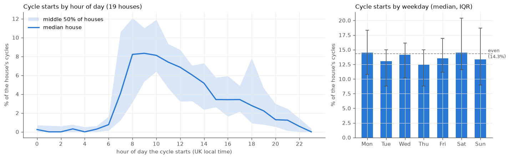
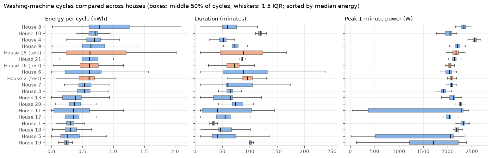
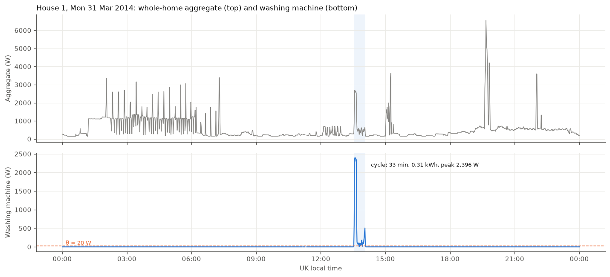
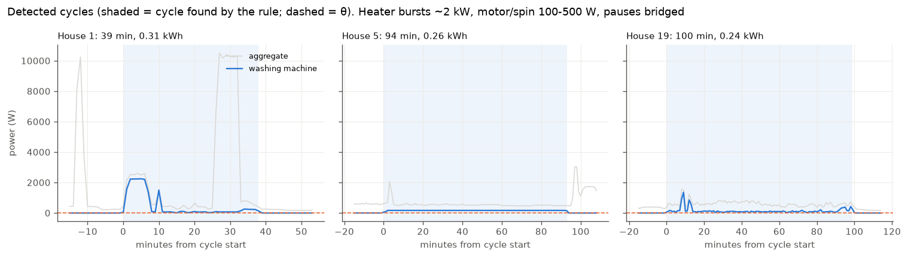
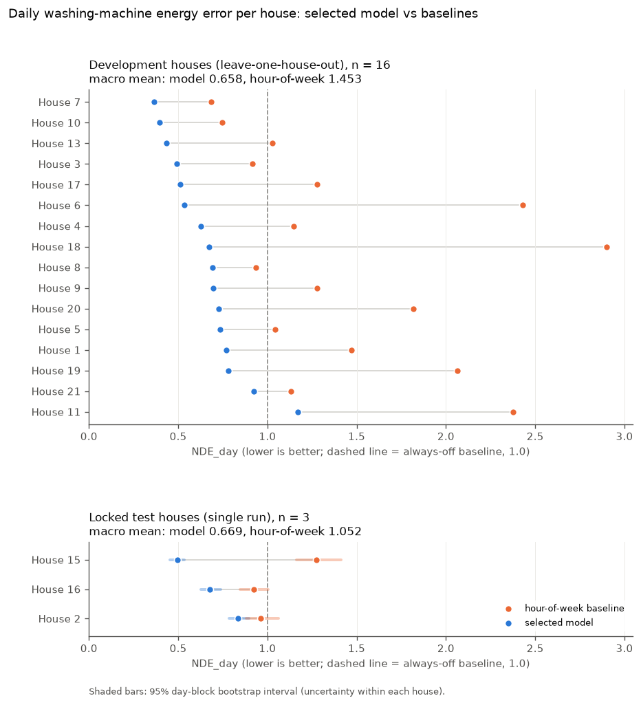
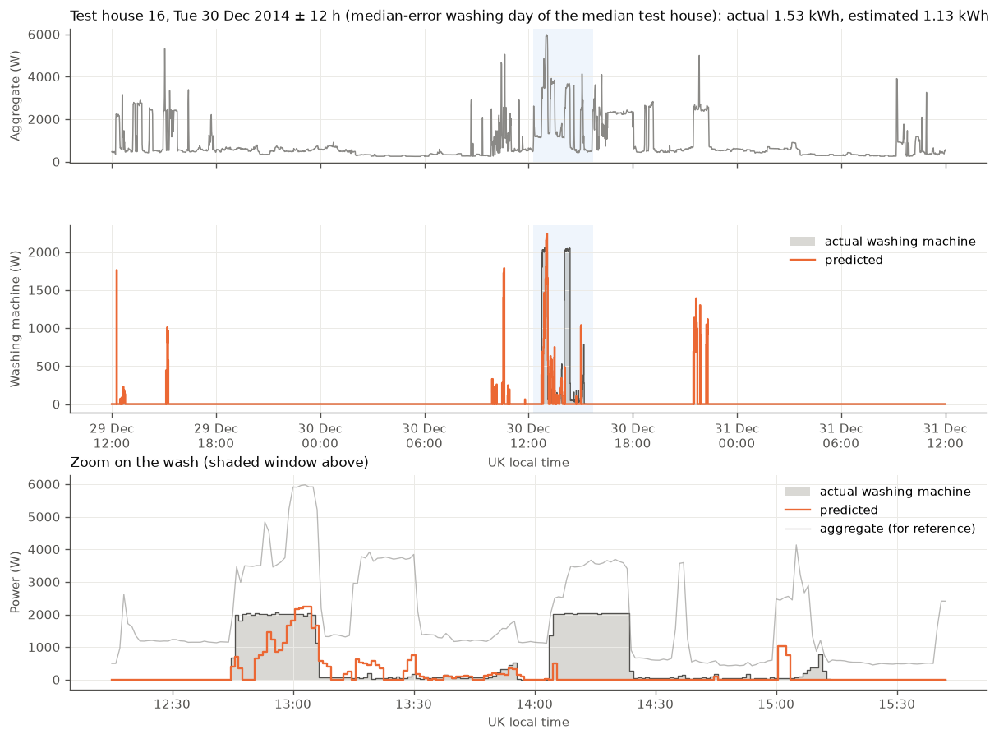
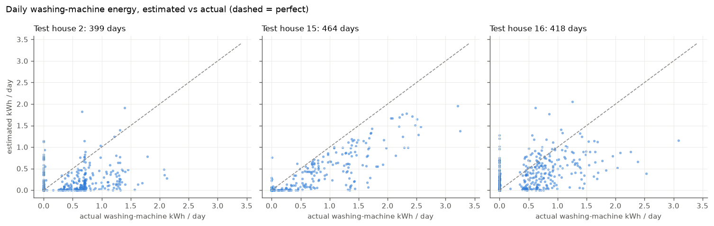
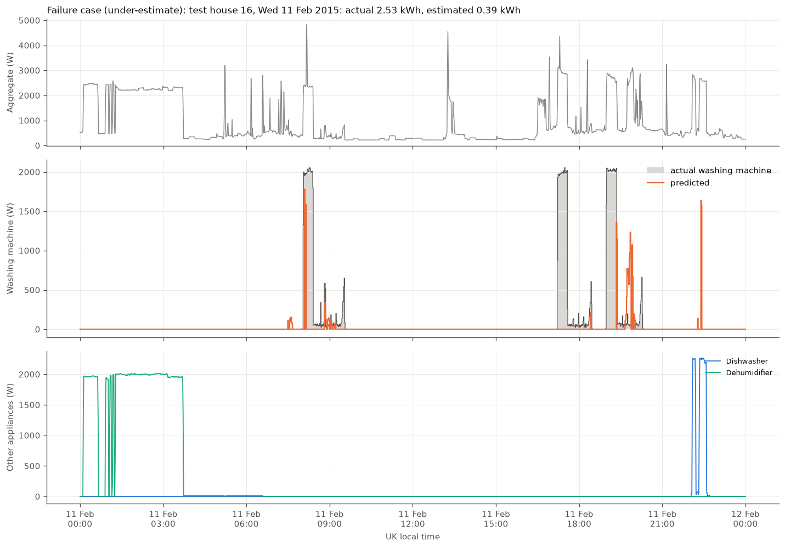
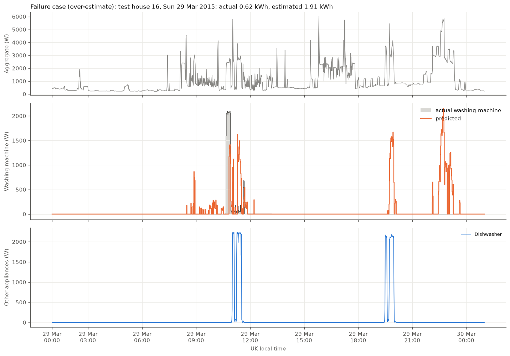

# RESULTS

This file covers Section 2 (washing-machine exploratory analysis) and Section 3 (the
disaggregation model) of the assignment. Data handling is described in [DATA.md](DATA.md);
the overview and run instructions are in [README.md](README.md).

Every number here is produced by code in `src/` and saved under `outputs/`. The file that
holds each number is given in brackets.

**Contents**

- [Part A. Washing-machine use](#part-a-washing-machine-use)
  - [A1. Homes, periods and data availability](#a1-homes-periods-and-data-availability)
  - [A2. Cycle rule](#a2-cycle-rule)
  - [A3. Usage by hour of day and day of week](#a3-usage-by-hour-of-day-and-day-of-week)
  - [A4. Cycle characteristics across homes](#a4-cycle-characteristics-across-homes)
  - [A5. Required plots](#a5-required-plots)
- [Part B. Disaggregation model](#part-b-disaggregation-model)
  - [B1. Problem, input and target](#b1-problem-input-and-target)
  - [B2. Houses, split and leakage prevention](#b2-houses-split-and-leakage-prevention)
  - [B3. Features](#b3-features)
  - [B4. Baselines and models tried](#b4-baselines-and-models-tried)
  - [B5. Metrics](#b5-metrics)
  - [B6. Model selection on development houses](#b6-model-selection-on-development-houses)
  - [B7. Final results on the test houses](#b7-final-results-on-the-test-houses)
  - [B8. Failure analysis](#b8-failure-analysis)
  - [B9. Follow-up experiments after the test run](#b9-follow-up-experiments-after-the-test-run)
  - [B10. Limitations of the model](#b10-limitations-of-the-model)

---

## Part A. Washing-machine use

### A1. Homes, periods and data availability

All **19 houses with a washing-machine channel** are used (every REFIT house except House 12,
which has none). The data are the official cleaned files, resampled to 1-minute means, with
our time-base correction and validity rules applied (DATA.md §3–5). Periods are the UK-local
dates of the first and last valid minute. House 13 stops on 24 Mar 2015 because its machine
was replaced the next day.

"Role" says how the house is used in Part B: development (dev) or locked test house. Test
houses appear in this EDA, but none of their data was used to choose any threshold.

| House | Role | WM channel | Period used | Valid days¹ | Valid minutes | Missing intervals > 5 min / > 1 day | WM off² | WM exactly 0 W | Cycles | Cycles / week |
|---|---|---|---|---|---|---|---|---|---|---|
| 1 | dev | A5 | 2013-10-09 – 2015-07-10 | 547 | 87.1% | 413 / 13 | 98.1% | 97.6% | 409 | 5.1 |
| 2 | test | A2 | 2013-09-17 – 2015-05-28 | 441 | 74.3% | 478 / 13 | 95.3% | 94.3% | 345 | 5.3 |
| 3 | dev | A6 | 2013-09-25 – 2015-06-02 | 400 | 75.0% | 827 / 20 | 94.3% | 93.0% | 613 | 9.3 |
| 4 | dev | A4 + A5 | 2013-10-11 – 2015-07-07 | 508 | 83.0% | 894 / 14 | 98.5% | 90.2% | 262 | 3.5 |
| 5 | dev | A3 | 2013-09-26 – 2015-07-06 | 535 | 88.4% | 842 / 12 | 94.2% | 53.4% | 838 | 10.2 |
| 6 | dev | A2 | 2013-11-28 – 2015-06-28 | 467 | 84.0% | 174 / 14 | 98.1% | 97.4% | 142 | 2.1 |
| 7 | dev | A5 | 2013-11-01 – 2015-07-08 | 521 | 86.8% | 135 / 13 | 91.6% | 74.7% | 873 | 11.5 |
| 8 | dev | A4 | 2013-11-01 – 2015-05-10 | 478 | 88.6% | 136 / 11 | 96.7% | 84.2% | 375 | 5.3 |
| 9 | dev | A3 | 2013-12-17 – 2015-07-08 | 443 | 79.9% | 86 / 13 | 97.2% | 90.2% | 252 | 3.9 |
| 10 | dev | A5 | 2013-11-20 – 2015-06-10 | 425 | 78.4% | 789 / 14 | 89.8% | 89.0% | 644 | 10.1 |
| 11 | dev | A3 | 2014-06-03 – 2015-04-26 | 289 | 75.4% | 54 / 10 | 98.4% | 91.6% | 119 | 2.8 |
| 13 | dev | A3 | 2014-01-17 – 2015-03-24 | 286 | 75.4% | 750 / 10 | 94.6% | 84.9% | 467 | 10.1 |
| 15 | test | A3 | 2013-12-17 – 2015-07-08 | 469 | 85.1% | 694 / 12 | 97.0% | 96.1% | 278 | 4.0 |
| 16 | test | A5 | 2014-01-10 – 2015-07-08 | 423 | 81.0% | 717 / 17 | 96.2% | 93.2% | 322 | 5.1 |
| 17 | dev | A4 | 2014-03-06 – 2015-06-19 | 418 | 91.4% | 148 / 9 | 97.6% | 96.6% | 318 | 5.2 |
| 18 | dev | A5 | 2014-03-07 – 2015-05-22 | 384 | 91.8% | 151 / 9 | 98.8% | 98.5% | 146 | 2.5 |
| 19 | dev | A2 | 2014-03-06 – 2015-06-20 | 427 | 92.6% | 300 / 9 | 96.1% | 86.5% | 269 | 4.3 |
| 20 | dev | A4 | 2014-03-20 – 2015-06-23 | 406 | 90.2% | 48 / 9 | 97.5% | 97.1% | 195 | 3.3 |
| 21 | dev | A3 | 2014-03-07 – 2015-06-05 | 393 | 88.7% | 90 / 10 | 96.6% | 96.1% | 247 | 4.3 |

¹ UK-local days with at least 90% valid minutes. ² Share of valid minutes below θ = 20 W.
"Valid minutes" is the share of minutes in the period that pass all validity rules.
**Total: 7,114 detected cycles.** [`outputs/eda_house_summary.csv`, `outputs/eda_cycles.csv`]

What the table shows:
- Data availability is uneven: 74% valid minutes in House 2, 93% in House 19. House 3 loses
  97,466 minutes to frozen readings hidden by the official forward-fill. Houses 10 and 11 lose
  29 and 49 days where the washing-machine monitor was dead while the household was at home.
  House 5 loses 25 "cycles" longer than 6 hours that are not washing programmes.
- **The washing machine is off 90–99% of the time in every house.** The target is sparse,
  which matters for the choice of metrics in Part B.
- House 5's machine idles at a few watts of standby, so it reads exactly 0 W in only 53% of
  minutes even though it is "off" (below 20 W) 94% of the time.

### A2. Cycle rule

> **A washing cycle starts when the machine draws at least 20 W, continues through pauses of
> up to 10 minutes, and counts only if it lasts at least 10 minutes.** A "cycle" longer than
> 6 hours is not a washing programme and is treated as bad data. A cycle "used the heater"
> if its highest minute reaches 1,500 W.

The rule is in `src/cycles.py`. The three numbers were chosen **on the 16 development houses
only** and then applied unchanged to every house:
- **θ = 20 W.** Standby readings sit at 0–5 W (House 5 spends 38% of minutes at 2–5 W). The
  5–30 W range is nearly empty in every house; real operation (drum, pump, heater) starts
  around 50 W. 20 W sits in the empty band.
- **G = 10 min.** Bridging pauses of up to 5 minutes merges 18,236 ON fragments into 8,277
  runs; going to 10 minutes changes little (7,746 runs), and longer bridges add almost
  nothing. Most pauses inside a cycle (drum stops, soaking) are shorter than 5 minutes.
- **L = 10 min.** Runs split clearly into 1-minute blips (981 runs) and real cycles with a
  mode of 30–120 minutes. Runs of 10 minutes or more contain 99.1% of all ON minutes.

Cycle length on development houses: median 65 min, 90th percentile 120 min, 99th percentile
232 min. This was the input for the model's 121-minute context window in Part B.

### A3. Usage by hour of day and day of week

Timing uses cycle **start times in UK local time**. Each house's starts are first turned into
shares, so busy houses do not dominate, and then summarised across the 19 houses.
[`outputs/eda_hour_of_day.csv`, `outputs/eda_day_of_week.csv`]

*Left: share of each house's cycles starting in each hour (line = median house, band = middle
half of houses). Right: share per weekday (bar = median house, whiskers = interquartile range
across houses).*

- **Hour of day:** washing is mostly a morning activity. In the median house, starts rise
  sharply from 07:00 and peak at 08:00–10:00 (about 8% of cycles per hour). The median house
  starts 39% of its cycles between 07:00 and 12:00, 21% between 12:00 and 16:00, 14% in the
  16:00–20:00 evening peak and 4% overnight (22:00–06:00).
- **Households differ a lot.** Houses 19 and 8 start 60% and 55% of their washes overnight,
  which suggests a delay timer (for example for an off-peak tariff). Houses 10 and 16 start
  42% and 38% of their washes in the 16:00–20:00 evening peak.
- **Day of week:** no strong weekday effect. The median house's share per weekday is
  12.4–14.5% (an even split is 14.3%), and the spread between houses is wider than the
  differences between days. Correcting for the number of valid days per weekday does not
  change this.

Timing is driven more by each household's routine than by the calendar. This suggested that
time-of-day features might help a model mainly by learning common routines, which may not
transfer to new homes. It was tested as an ablation in Part B.

### A4. Cycle characteristics across homes

*Each box covers the middle 50% of a house's cycles; the black tick is the median. Test
houses are orange. Houses are sorted by median energy per cycle.*

| House | Role | Median energy / cycle (kWh) | Median duration (min) | Median peak (W) | Cycles using heater | WM energy per valid day (kWh) |
|---|---|---|---|---|---|---|
| 1 | dev | 0.31 | 33 | 2,322 | 93% | 0.25 |
| 2 | test | 0.61 | 96 | 2,088 | 93% | 0.44 |
| 3 | dev | 0.53 | 64 | 1,919 | 92% | 0.69 |
| 4 | dev | 0.69 | 52 | 2,555 | 96% | 0.37 |
| 5 | dev | 0.26 | 42 | 2,054 | 73% | 0.59 |
| 6 | dev | 0.61 | 89 | 2,043 | 78% | 0.17 |
| 7 | dev | 0.53 | 60 | 2,082 | 98% | 0.92 |
| 8 | dev | 0.78 | 59 | 2,336 | 95% | 0.70 |
| 9 | dev | 0.64 | 73 | 2,208 | 96% | 0.38 |
| 10 | dev | 0.70 | 120 | 2,049 | 90% | 0.91 |
| 11 | dev | 0.36 | 41 | 2,274 | 61% | 0.18 |
| 13 | dev | 0.39 | 65 | 2,112 | 84% | 0.54 |
| 15 | test | 0.62 | 89 | 2,175 | 87% | 0.42 |
| 16 | test | 0.61 | 72 | 2,048 | 96% | 0.47 |
| 17 | dev | 0.35 | 55 | 2,037 | 81% | 0.25 |
| 18 | dev | 0.31 | 47 | 2,188 | 91% | 0.12 |
| 19 | dev | 0.24 | 102 | 1,710 | 63% | 0.15 |
| 20 | dev | 0.37 | 74 | 2,271 | 96% | 0.20 |
| 21 | dev | 0.62 | 86 | 2,142 | 93% | 0.38 |

- **Energy per cycle varies about 3-fold between homes**, from a median of 0.24 kWh (House 19)
  to 0.78 kWh (House 8). It also varies within homes: the middle half of House 15's cycles
  spans about 0.25–1.2 kWh, which reflects different programmes and temperatures.
- **Duration is more house-specific than energy.** Houses 10, 19 and 21 run almost the same
  length every time (one favourite programme); other houses vary widely.
- **Peak power is about 2.0–2.6 kW in nearly every home.** This is the heating element, and
  it is what makes a wash visible in the aggregate. But 2–39% of cycles never reach 1.5 kW
  (cold or eco washes, most often in Houses 5, 11 and 19). These cycles draw only 100–500 W
  and are hard to see in a whole-home signal, which we expected to be a failure case for the
  model.
- **Washing-machine energy is small:** 0.12–0.92 kWh per valid day, which is 1.1–6.8% of the
  same home's measured consumption (median 3.3%). Any saving from washing behaviour is
  therefore a small share of a household's bill (relevant for the Recommendation).

House 4 has two washing machines. Appliance4 (Servis) has 60 cycles and Appliance5 (Zanussi)
213 cycles; both are ON together in only 214 minutes, 1.9% of the minutes when either is ON.
The summed channel gives 262 cycles, close to 60 + 213 because a few overlapping washes merge.
[`outputs/eda_extra.json`]

### A5. Required plots

**(i) Representative 24-hour trace.** House 1 (development), Monday 31 Mar 2014. The day was
picked by rule: a fully valid day with a single cycle whose energy and duration are closest
to the house's median.

The 33-minute cycle (0.31 kWh, peak 2.4 kW) shows in the aggregate as a ~2.4 kW block at
13:30 followed by low motor activity. The same aggregate also has a dozen 2.5–3.4 kW spikes
overnight and in the evening that are not the washing machine. A model therefore has to tell
the washing machine's heater-block-plus-motor pattern apart from other heating loads; looking
for "about 2 kW" is not enough.

**(ii) Detected cycles.** The median-energy cycle from three development houses, with the
aggregate behind it.

The rule captures the whole cycle in each case and bridges the short pauses. House 1 shows the
classic shape: a ~2.2 kW heating phase at the start, then about 30 minutes of drum and spin at
100–300 W. Houses 5 and 19 show the hard case: their typical cycle is a long, cool wash at
about 100–200 W with no heater burst. In House 5 it barely changes the aggregate.

**(iii) Cross-house comparison.** See [A4](#a4-cycle-characteristics-across-homes): energy per
cycle, duration and peak power for all 19 homes.

---

## Part B. Disaggregation model

### B1. Problem, input and target

- **Task:** for every minute, estimate the washing machine's power (W) using only the
  household's aggregate power. This is a regression problem on 1-minute data.
- **Input:** the 1-minute mean of the official cleaned aggregate, after our time-base
  correction (DATA.md §4.2). Only the aggregate is used; no appliance channel goes into the
  model.
- **Ground truth:** the house's washing-machine channel at 1-minute resolution (House 4: the
  sum of its two machines).
- **Evaluable minutes:** a minute is used for training and scoring only if its target and
  aggregate are valid (DATA.md §5.1) and at least 90% of the 61-minute window around it has
  valid aggregate data. Invalid minutes are never filled.
- **Output use:** daily washing-machine energy and the timing of washes. The model is meant
  for offline analysis of historical data, not for real-time use (see B3).

### B2. Houses, split and leakage prevention

**Split by household.** All 19 houses met the eligibility rule (washing-machine channel, at
least 90 valid days and at least 30 cycles under a provisional rule). Before any model code
was written, three **test houses (2, 15, 16)** were drawn at random with seed 42
(`src/split.py`, `outputs/test_lock.json`, `config.yaml`). The pipeline re-runs the draw
and stops if it does not match.

**Development houses:** 1, 3, 4, 5, 6, 7, 8, 9, 10, 11, 13, 17, 18, 19, 20, 21. Every
choice (thresholds, loss, rounds, model type, features) was made with **leave-one-house-out
(LOHO) cross-validation** on these 16 houses: in each fold the model is trained on 15 houses
and predicts every evaluable minute of the 16th. The selected configuration was then
retrained on all 16 houses and applied **once** to the test houses.

Periods: each house's full valid period from the table in A1 (House 13 before 25 Mar 2015).

Why a household split: the realistic use is a model applied to homes it has never seen. A
random split of overlapping minutes or windows would put almost identical neighbouring minutes
from the same wash into both training and test data and give an over-optimistic score.

How leakage is avoided:
- No house is ever in both training and evaluation of the same fold, and the test houses were
  never used for any choice.
- Features use only the aggregate. There is no lagged washing-machine power and nothing from
  other appliance channels.
- θ, G, L and the step size used in the features were set from development houses only.
- Feature windows are computed per house, so they never cross from one house into another.
- The hour-of-week baseline is learned only from the training houses of each fold.
- The test houses were scored once. The result is reported as it came out.

Training uses every 5th evaluable minute to keep training time manageable (features are
still computed on the full series). Evaluation uses all evaluable minutes.

### B3. Features

41 features per minute (`src/features.py`): 37 computed from the aggregate only, plus 4
calendar features (last row):

| Group | Features | Why |
|---|---|---|
| Point values | x(t), x(t±1), x(t±2) | local level |
| Changes | x(t) − x(t−1), x(t+1) − x(t); sum of absolute changes over 15 and 61 min | switching activity (heater steps, spin) |
| Centred window statistics, 5 / 15 / 31 / 61 min | mean, std, min, max, range | context at several time scales |
| Heater-sized steps, 31 / 61 min | number of rises and drops larger than 1,000 W | heater on/off signature (1,000 W from development-house step sizes) |
| Long context, 121 min | mean, std | whole-cycle scale (99% of development cycles are under 232 min, median 65 min) |
| Level above baseload | x(t) minus the rolling 24-hour 5th percentile | reduces differences between homes |
| Data validity | share of valid minutes in the 61-minute window | lets the model discount windows near gaps |
| Calendar (ablation, kept) | hour of day and day of week as sine/cosine, UK local time | tested separately because it may only learn routines |

The windows are **centred** on the minute being predicted, so they use up to 60 minutes of
"future" aggregate data. This follows the midpoint idea of Seq2Point (Zhang et al. 2018). It
suits offline disaggregation of historical data but means the model is **not a real-time
model**.

### B4. Baselines and models tried

Baselines (`src/baselines.py`):
- **Always-off:** predicts 0 W at every minute. By definition NDE_day = 1.0 and F1 = 0.
- **Hour-of-week profile:** the average washing-machine power for each of the 168 hours of
  the week, learned from the training houses (each house weighted equally). If a model cannot
  beat this, it is learning household habits rather than electrical signatures.

Models (`src/models.py`, `colab/seq2point_refit.py`). All candidates, grids and the selection steps
were written down before any model was trained:

| Candidate | Description |
|---|---|
| Single-stage LightGBM | one regressor from features to power; L2 loss vs Tweedie loss (variance power 1.5); 100/200/400/800 boosting rounds |
| + zeroing threshold τ | predictions below τ ∈ {0, 5, 10, 20, 50} W set to 0 |
| Two-stage LightGBM | a classifier for P(ON) (ON = power ≥ 20 W) and a regressor trained only on ON minutes. Soft gating: P(ON) × power. Hard gating: power if P(ON) > t, with t ∈ {0.3, …, 0.7} |
| + calendar features | the 4 calendar features added to the current winner |
| Seq2Point CNN | 5 convolution layers + dense layer on a 121-minute window, run on Google Colab (GPU) with the same folds, training minutes and evaluable minutes |

All LightGBM settings other than the number of rounds were fixed in advance (learning rate
0.05, 63 leaves, at least 500 rows per leaf, 80% feature and row sampling, L2
regularisation 1, seed 42). The two-stage idea is inspired by Subtask Gated Networks (Shin
et al. 2019), which split the problem into "is it on" and "how much"; our version is two
separately trained LightGBM models, not a reproduction of that network.

**Promotion rule** (fixed before results): a more complex candidate replaces the simpler one
only if it lowers the macro-average NDE_day over the 16 development houses **and** is better
in at least 8 of the 16 houses.

Why LightGBM as the main model family: it trains in minutes on CPU, handles missing values,
and its errors can be inspected. The assignment says model complexity is not assessed, so the
CNN was kept as a challenger rather than the starting point.

### B5. Metrics

All metrics are computed per house on evaluable minutes, then averaged across houses
(macro mean), so a house with more data does not dominate (`src/metrics.py`).

| Metric | Definition | Why it is useful |
|---|---|---|
| **NDE_day** (primary) | Σ over days of \|estimated − actual daily kWh\| ÷ Σ actual daily kWh, over days with ≥ 90% evaluable minutes | measures daily washing energy, which is what a utility would use. Errors on different days cannot cancel. **Lower is better.** Always-off scores exactly 1.0, so values below 1.0 mean the model adds information |
| Daily MAE (kWh) | mean \|estimated − actual\| per day | NDE_day in physical units |
| Minute MAE (W) | mean absolute error per minute | standard, but misleading for a machine that is off 90–99% of the time: always-off already scores well on it |
| MAE while ON (W) | minute MAE on minutes where the machine is actually ON | shows how well power is estimated during washes |
| SAE | \|total estimated − total actual energy\| ÷ total actual | whole-period energy bias; can hide errors that cancel out |
| ON precision / recall / F1 | minute-level ON state at 20 W | whether the model knows *when* the machine runs, not how much energy |
| Cycle recall / precision | the A2 cycle rule applied to actual and predicted power; a cycle counts as found if it overlaps a cycle on the other side | whether washes as events are found, which supports counting washes |

NDE_day is our own definition. It is close in spirit to the energy-based metrics discussed by
Zhang et al. (2018) and Pereira & Nunes (2018), but it is not taken from either. It is **not**
a classification accuracy: an NDE_day of 0.669 means the daily energy errors add up to 66.9%
of the actual washing energy over the evaluated days.

### B6. Model selection on development houses

All numbers in this section are LOHO predictions on the 16 development houses. They were used
for selection, so they are slightly optimistic. The selection decision was saved before the
test run (`outputs/metrics/selection.json`).
[`outputs/metrics/dev_all_variants_macro.csv`, `outputs/metrics/dev_all_variants_per_house.csv`]

| Model (development LOHO, macro mean over 16 houses) | NDE_day ↓ | Range over houses | Minute MAE (W) | MAE while ON (W) | SAE | ON F1 | Cycle recall | Cycle precision |
|---|---|---|---|---|---|---|---|---|
| Always-off (baseline) | 1.000 | 1.00–1.00 | 17.6 | 484 | 1.000 | 0.00 | 0.00 | – |
| Hour-of-week profile (baseline) | 1.453 | 0.69–2.90 | 33.2 | 459 | 0.833 | 0.11 | 0.64 | 0.19 |
| LightGBM L2, 800 rounds | 0.817 | 0.34–1.55 | 23.8 | 347 | 0.297 | 0.36 | 0.96 | 0.19 |
| LightGBM Tweedie, 800 rounds | 0.744 | 0.30–1.24 | 19.5 | 368 | 0.372 | 0.44 | 0.92 | 0.26 |
| + zeroing τ = 20 W | 0.733 | 0.30–1.19 | 18.9 | 370 | 0.390 | 0.44 | 0.92 | 0.26 |
| Two-stage, soft gating | 0.741 | 0.31–1.36 | 21.1 | 347 | 0.312 | 0.42 | 0.94 | 0.23 |
| Two-stage, hard gating P(ON) > 0.4 | 0.685 | 0.34–1.09 | 18.3 | 348 | 0.390 | 0.48 | 0.75 | 0.51 |
| **Two-stage, hard 0.4, + calendar (selected)** | **0.658** | 0.36–1.17 | 17.8 | 342 | 0.385 | 0.50 | 0.76 | 0.55 |
| Seq2Point CNN (Colab) | 0.802 | 0.36–2.02 | 20.5 | 326 | 0.403 | 0.40 | 0.90 | 0.28 |

Decisions, in the pre-declared order:
1. **Loss: Tweedie.** It beat L2 at every rounds count (best 0.744 vs 0.817, both at 800
   rounds). Most minutes are exactly 0, and L2 spreads small predictions over OFF time;
   Tweedie is designed for "many zeros plus occasional large values". 800 rounds, the top of
   the grid, was best. We did not extend the grid after seeing this (listed as an improvement).
2. **τ = 20 W:** small gain, 0.744 → 0.733.
3. **Two-stage, hard gating promoted:** 0.685, better in 12 of 16 houses. It finds fewer ON
   minutes (recall 0.45 vs 0.71) but produces far fewer false ON minutes and false cycles
   (cycle precision 0.51 vs 0.26). Thresholds 0.4 and 0.5 were close (0.685 vs 0.690); soft
   gating was worse. The classifier was well calibrated (expected calibration error 0.004,
   Brier score 0.023; the limit fixed in advance was 0.05), so no recalibration was applied
   [`figures/s3_two_stage_reliability.png`].
4. **Calendar features promoted:** 0.658, better in 11 of 16 houses. Time of day helps on new
   homes on average, which fits the shared morning pattern in A3, but not everywhere
   (House 8: 0.585 → 0.691; House 10: 0.338 → 0.395). Risk: it encodes UK routines and may
   not transfer to other populations.
5. **Seq2Point not promoted:** 0.802, better than the selected model in only 4 of 16 houses.
   It has the lowest error during ON minutes (326 W) but fails badly in two homes (House 18:
   2.02, House 11: 1.52). Because it lost, the test houses were never sent to Colab.

**Selected for the single test run:** two-stage LightGBM (ON/OFF classifier + power
regressor trained on ON minutes, 800 rounds each), 37 aggregate features + 4 calendar
features, with power reported only when P(ON) > 0.4. Retrained on all 16 development
houses (`cache/models/final_*.txt`).

Weak development houses: **House 11** (one occupant, about 3 washes a week, 39% of cycles
without the heater) is worse than always-off for every model (1.17 for the selected one), and
**House 21** is only slightly better than always-off (0.92).

### B7. Final results on the test houses

The selected model was retrained on all 16 development houses and applied **once** to test
houses 2, 15 and 16 (`src/final_test.py`). Both baselines were scored on the same minutes.
[`outputs/metrics/test_results.json`, `outputs/metrics/test_per_house.csv`]

| Test house | Days | Actual WM kWh/day | **NDE_day, model (95% CI)** | NDE_day always-off | NDE_day hour-of-week | Daily error (kWh), model / always-off | Minute MAE (W), model / always-off | SAE | ON precision / recall / F1 | Cycle recall / precision |
|---|---|---|---|---|---|---|---|---|---|---|
| 2 | 399 | 0.42 | **0.835** (0.79–0.90) | 1.000 | 0.962 | 0.35 / 0.42 | 19.1 / 18.2 | 0.61 | 0.63 / 0.18 / 0.28 | 0.67 / 0.70 |
| 15 | 464 | 0.41 | **0.495** (0.45–0.54) | 1.000 | 1.272 | 0.20 / 0.41 | 9.9 / 17.4 | 0.47 | 0.93 / 0.51 / 0.66 | 0.76 / 0.89 |
| 16 | 418 | 0.47 | **0.678** (0.63–0.74) | 1.000 | 0.923 | 0.32 / 0.47 | 22.3 / 19.8 | 0.31 | 0.54 / 0.33 / 0.41 | 0.74 / 0.49 |
| **Macro mean** | | | **0.669** (0.64–0.70) | 1.000 | 1.052 (1.00–1.12) | 0.29 / 0.43 | 17.1 / 18.5 | 0.46 | 0.70 / 0.34 / 0.45 | 0.72 / 0.69 |

*Per-house NDE_day (lower is better) on the 16 development houses (top) and the 3 test houses
(bottom). The dashed line is always-off. Shaded bars on the test panel are the 95% bootstrap
intervals.*

How to read these results:
- **On daily washing energy, the model beats both baselines in all three test houses**, and
  each model interval lies below 1.0. On average it cuts the daily washing-energy error by a
  third (0.29 vs 0.43 kWh per day).
- **On minute MAE it is worse than always-off in Houses 2 and 16.** This is the "MAE trap":
  a machine that is off most of the time gives always-off a low minute error, and every false
  ON minute costs the model. This is why minute MAE was not the selection metric.
- **It knows *when* a wash happens better than *how much* energy it used.** About 7 in 10 real
  cycles are found and about 7 in 10 predicted cycles are real (cycle recall 0.72, precision
  0.69). At minute level, 70% of predicted ON minutes are correct but only 34% of real ON
  minutes are found.
- **Total washing energy is under-estimated.** The model's total is 39% (House 2), 53%
  (House 15) and 69% (House 16) of the actual total. Part of that total is false energy from
  look-alike loads (B8), so the share of real wash energy recovered is lower still.
- **Houses differ a lot:** House 15 is easiest (0.495), House 2 hardest (0.835).
- **Development vs test:** the test result (0.669) is close to the development estimate
  (0.658). This is encouraging evidence that the selection did not overfit the development
  houses, but with three test houses it is not proof.

**What the confidence interval means.** The 95% intervals come from a day-block bootstrap:
whole days are resampled with replacement within each test house, 1,000 times. They describe
uncertainty from *which days* were observed in these three homes. They do not cover the
variation between homes, so they are not a guarantee of performance in an arbitrary new home.
The development range (0.36–1.17 over 16 houses) is a better guide to how much results can
vary from home to home.

**Actual vs predicted.** The window was chosen by a fixed rule: the test house with the median
score (House 16), and among its washing days the one with the median error, ± 12 hours.
[`figures/s3_actual_vs_predicted.png`]

*Top: aggregate. Middle: actual washing-machine power (grey area) and prediction (orange) over
48 hours. Bottom: zoom on the wash.*

The wash at 12:45 on 30 Dec 2014 is detected. The first 2 kW heating phase is partly matched
(the prediction ramps up instead of jumping), the second 2 kW heating block at about 14:05 is
missed completely, and the low-power drum phases are tracked reasonably well. Elsewhere in the
48 hours the model fires briefly at four other times, each when a 1.5–2.5 kW load switches on
in the aggregate. Daily result: 1.13 kWh estimated vs 1.53 kWh actual.

**Daily energy, estimated vs actual** for every counted test day:

Most points lie below the diagonal, i.e. daily energy is under-estimated. The column of points
at "actual 0" are days with false washes, mostly under 0.5 kWh. House 15 follows the diagonal
best; House 2 has many wash days estimated close to zero.

### B8. Failure analysis

Causes were checked with data (the other appliance channels and the cycle type), not assumed.
Failure days were chosen by a fixed rule: the largest over-estimate and the largest
under-estimate among all test days. [`outputs/metrics/test_failure_analysis.json`]

| Test house | Actual WM energy | Estimated (share of actual) | Heater cycles found | Energy recovered inside heater cycles | No-heater cycles found | False-ON minutes with another monitored load ≥ 1 kW |
|---|---|---|---|---|---|---|
| 2 | 196 kWh | 76 kWh (39%) | 91% of 313 | 22% | 30% of 20 | 21% (dishwasher 18%, kettle 4%) |
| 15 | 199 kWh | 105 kWh (53%) | 92% of 240 | 51% | 13% of 30 | 41% (tumble dryer 38%) |
| 16 | 207 kWh | 143 kWh (69%) | 91% of 308 | 37% | 64% of 11 | 17% (dishwasher 15%) |

**1. Heating blocks are under-estimated (the main failure).** About 91% of heater washes are
found, but only 22–51% of the energy inside them is recovered. The underestimate example below
is House 16 on 11 Feb 2015: actual 2.53 kWh, estimated 0.39 kWh. There are three heating blocks of
roughly 20 minutes at 2 kW; the model fires briefly at the first and largely misses the other two.

*Bottom panel: other monitored appliances drawing at least 1 kW that day.*

A follow-up diagnostic on development houses (EXP-01, B9) found that the lost heater energy
splits roughly evenly between the gate being closed (P(ON) ≤ 0.4) and the regressor predicting
too few watts when the gate is open. A likely reason, not proven: long ~2 kW blocks are
ambiguous in the aggregate, because training homes also contain other long 2 kW loads (heaters,
tumble dryers, a 2 kW dehumidifier in House 16), and the model is rewarded for being cautious
when unsure. The same panel shows one positive check: the dehumidifier ran for 3.5 hours at
2 kW and the model correctly ignored it.

**2. Look-alike heating loads cause false washes.** The over-estimate example is House 16 on
29 Mar 2015: actual 0.62 kWh, estimated 1.91 kWh.

The dishwasher's 2.2 kW heater blocks have the same shape as a washing machine's. In the morning
they overlap the real wash; in the evening they are predicted as a second wash. A further false
wash at about 22:00 coincides with a 3–6 kW load that no monitor records. Across the test houses
the dishwasher (Houses 2 and 16) and the tumble dryer (House 15) are the most common
identifiable confusers. Most other false-ON minutes do not coincide with any monitored ≥ 1 kW
load, which points to unmonitored appliances.

**3. Cold or eco washes without the heater are mostly missed** (13–64% found). In these three
test homes they hold only about 1% of washing energy. In homes that wash cold more often
(development Houses 5, 11 and 19, where 27–39% of cycles do not use the heater) they matter
more, and House 11 is worse than always-off for every model.

### B9. Follow-up experiments after the test run

After the test result was frozen (`outputs/frozen_v1/`), three diagnostics were run on
**development houses only** to understand the heater-block failure. None of them changed the
model, a threshold or a reported test number. Each was written up before it was run, in
[`experiments/`](experiments/).

| Experiment | Question | Result |
|---|---|---|
| [EXP-01](experiments/EXP-01_heater_diagnostic.md) | Where is heater energy lost? | Inside true heating blocks the model recovers 44% of the energy; 25% is lost because the gate is closed and 31% because the regressor predicts too few watts. [`outputs/diagnostics/exp01_*`] |
| [EXP-02](experiments/EXP-02_lookalike_check.md) | Do other heating loads look like washing-machine heating to the model? | Look-alike blocks get much lower P(ON) than real heating blocks (mean 0.16 vs 0.46; ROC AUC 0.83), but they are 3.3 times more numerous and already receive 459 kWh of false energy. The regressor is roughly calibrated by predicted power. [`outputs/diagnostics/exp02_*`] |
| [EXP-03](experiments/EXP-03_block_fill.md) | Can post-processing fill missed heating blocks using ~2 kW steps in the aggregate? | No. Development NDE_day got worse (0.881 vs 0.658; better in only 3 of 16 houses). It recovered 272 kWh of error but added 1,150 kWh, because heater-sized step pairs from other loads outnumber washing-machine ones about 16 to 1. [`outputs/diagnostics/exp03_*`, `figures/exp03_block_fill.png`] |

Conclusion: the missing heater energy cannot be recovered by post-processing this model. It
would need a model that sees the step *and* the surrounding washing-machine pattern, for
example step-aware features or a sequence model trained with more emphasis on heater blocks.

### B10. Limitations of the model

- **Energy is biased low.** Totals are 39–69% of the actual totals on the test houses. The model is
  better at telling *whether* a wash happened than *how much* energy it used.
- **Results vary strongly between homes.** Development NDE_day ranges from 0.36 to 1.17, and one
  development home (House 11) is worse than always-off.
- **Few test homes.** Three test houses give an unbiased estimate, but not a precise one for the
  wider population.
- **Look-alike loads.** Dishwashers, tumble dryers and unmonitored heating loads cause false
  washes.
- **Cold washes** without the heater are mostly invisible.
- **Calendar features** encode UK routines and may not transfer to other countries.
- **Offline only.** Centred windows use future data; a real-time version would need causal
  windows and would likely be less accurate.
- **Data quality.** The official forward-fill can hide short outages that our validity rules
  cannot detect (DATA.md §5.4).
